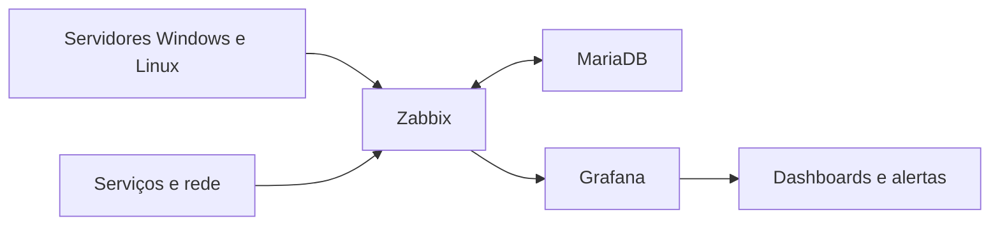

# Monitoramento e dashboards

Implementei uma estrutura de monitoramento com Zabbix e Grafana para acompanhar servidores Windows e Linux, serviços e rede.

## O que foi feito

- Zabbix instalado e configurado em servidor Ubuntu.
- MariaDB configurado como banco de dados do Zabbix.
- Monitoramento de servidores, serviços e rede.
- Dashboards no Grafana para visualizar métricas e apoiar a análise do ambiente.
- Alertas para facilitar a identificação de falhas.

## Tecnologias

Zabbix, Grafana, MariaDB, Ubuntu, Windows e Linux.

## Visão geral

Este repositório apresenta o projeto de forma resumida. Não inclui configurações, endereços ou capturas do ambiente de produção.
